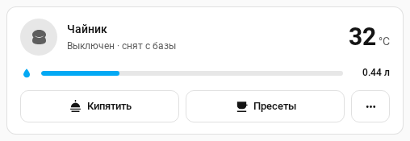
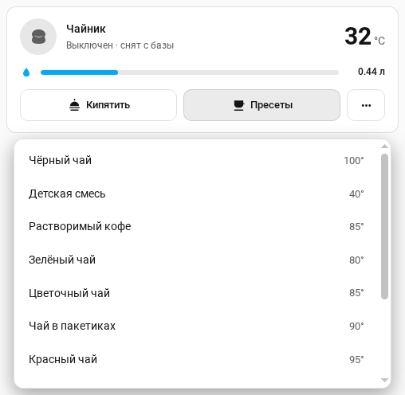

# Kettle Mushroom Card

Минималистичная Lovelace-карточка для электрического чайника в стиле [Mushroom](https://github.com/piitaya/lovelace-mushroom). Разработана и протестирована на SkyKettle (Redmond), но подойдёт любому чайнику с похожим набором сущностей.




## Возможности

- текущая температура воды (крупно);
- объём воды с индикатором заполнения;
- состояние: нагрев / выключен, на базе / снят с базы;
- кнопка **«Кипятить»** — запуск/остановка кипячения;
- кнопка **«Пресеты»** — выпадающее меню режимов (чёрный чай, пуэр, зелёный чай, детская смесь и т.д.);
- кнопка **меню (⋮)** — настройки чайника: звук, подсветка, защита от детей;
- цвет иконки меняется при нагреве;
- светлая и тёмная темы (следует теме Home Assistant).

## Установка

### Вручную

1. Скопируйте `kettle-mushroom-card.js` в папку `config/www/` на сервере Home Assistant.
2. Настройки → Панели → ⋮ → Ресурсы → добавьте ресурс:
   - URL: `/local/kettle-mushroom-card.js`
   - Тип: `JavaScript-модуль`

### Через магазин (Marketplace/HACS)

Добавьте этот репозиторий как пользовательский репозиторий типа «Lovelace/Плагин» и установите карточку — ресурс появится автоматически.

## Настройка

Минимальная конфигурация — достаточно указать главную сущность `water_heater`, остальные сущности карточка найдёт по префиксу:

```yaml
type: custom:kettle-mushroom-card
entity: water_heater.kettle
```

Полная конфигурация:

```yaml
type: custom:kettle-mushroom-card
entity: water_heater.kettle            # обязательно: сущность нагрева
name: Чайник                           # необязательно: имя на карточке
volume_max: 1.7                        # максимальный объём, л (по умолчанию 1.7)
temperature_entity: sensor.kettle_temperature
volume_entity: sensor.kettle_weight
power_entity: switch.kettle_power
preset_entity: select.kettle_preset
base_entity: binary_sensor.kettle_base
sound_entity: switch.kettle_sound
backlight_entity: switch.kettle_pwk_1775cgld_backlight
lock_entity: switch.kettle_child_lock
```

### Свои названия пресетов

```yaml
presets:
  black_tea:
    name: Чёрный чай
    temp: 100
  baby_bottle:
    name: Детская смесь
    temp: 40
```

## Требования

- Home Assistant 2023.4+
- Чайник с сущностями `water_heater`, датчиком температуры и (желательно) датчиком объёма/веса воды.
